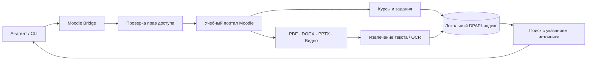

# MISIS Moodle Bridge

[](https://github.com/Ai-b0ss/misis-moodle-bridge-public/actions/workflows/verify-public.yml)

**AI-агент получает доступ к учебному порталу, находит нужные материалы и помогает разбирать задания непосредственно в диалоге.**

Локальный Python-клиент для **Moodle МИСИС (`newlms.misis.ru`)**. Связывает языковую модель с курсами, заданиями, сроками, оценками и учебными документами с учётом прав авторизованного пользователя.

[**Кейс в портфолио**](https://i99er-igor-portfolio.static.hf.space/cases.html#moodle) · [**Гибридный поиск**](HYBRID_README_2026-10-24.md) · [**Мультимодальный конвейер v12**](MULTIMODAL_V12_REPORT_2026-10-25.md) · [**CLI**](moodle_client.py)

## Что умеет

| Возможность | Реализация |
| --- | --- |
| **Учебный контекст** | Курсы, модули, задания, оценки и сроки из доступного Moodle |
| **Поиск в учебном портале** | Единый локальный индекс страниц, материалов и метаданных с повторной проверкой доступа |
| **Документы** | PDF, DOCX, PPT/PPTX, таблицы и диаграммы; OCR для сканов и изображений |
| **Презентации и видео** | Извлечение текста из доступных слайдов и ограниченная выборка видеокадров |
| **Интеграция с AI** | CLI/Python как источник точного учебного контекста для языкового агента |
| **Авторизация** | Локальная защита авторизации и индексов через Windows DPAPI |

## Архитектура



Мост работает на обычном Windows-компьютере с авторизованным пользовательским доступом. Учебные материалы обрабатываются локально; результаты поиска сохраняют ссылку на исходный документ, страницу или слайд. [Техническое описание](MULTIMODAL_V12_REPORT_2026-10-25.md).

## Измеримые результаты

<small>Зафиксированные испытания версии v12, 25 октября 2026 года.</small>

| Проверка | Результат |
| --- | --- |
| Автоматические тесты версии v12 | **116 из 116 PASS** |
| Презентация из Moodle | **54 слайда**, 9 таблиц, 20 изображений обработаны структурным анализом |
| Реальный PDF из Moodle | OCR извлёк **814 символов** из графических элементов |
| Локальный поиск | Мультимодальный запрос завершился успешно с указанием происхождения результата |

[**Полный протокол испытаний**](MULTIMODAL_V12_REPORT_2026-10-25.md) · [**Гибридный поиск и индекс**](HYBRID_README_2026-10-24.md)

## Начало работы

На компьютере с разрешённым доступом к своему Moodle:

```powershell
python moodle_client.py check
python moodle_client.py overview
python moodle_client.py deadlines
python moodle_client.py hybrid-search --query "вычислительные" --limit 20
```

Изолированные тесты клиента:

```powershell
python -m unittest test_client -q
```

**Проверено при подготовке публичной копии:** синтаксис всех Python-модулей; 10 из 10 тестов `test_client` успешно пройдены в изолированном окружении без реального входа в Moodle.

## Технологии и структура

Python, Moodle Web Services API, Windows DPAPI, локальное индексирование и поиск, PyMuPDF, OOXML, RapidOCR, FFmpeg. Основные модули: [`moodle_client.py`](moodle_client.py), [`moodle_hybrid.py`](moodle_hybrid.py), [`moodle_multimodal.py`](moodle_multimodal.py), [`moodle_materials.py`](moodle_materials.py).

**Моя роль:** архитектура системы, интеграции с Moodle API, локальная авторизация, конвейер обработки материалов, поиск, испытания и сборка. Реализация велась с AI-инструментами при нулевом бюджете на платные API.

---

Публичная версия — отдельный снимок v12. Личные токены, cookies, зашифрованные пользовательские индексы и учебные файлы не публикуются. Клиент работает в пределах прав авторизованного пользователя.
